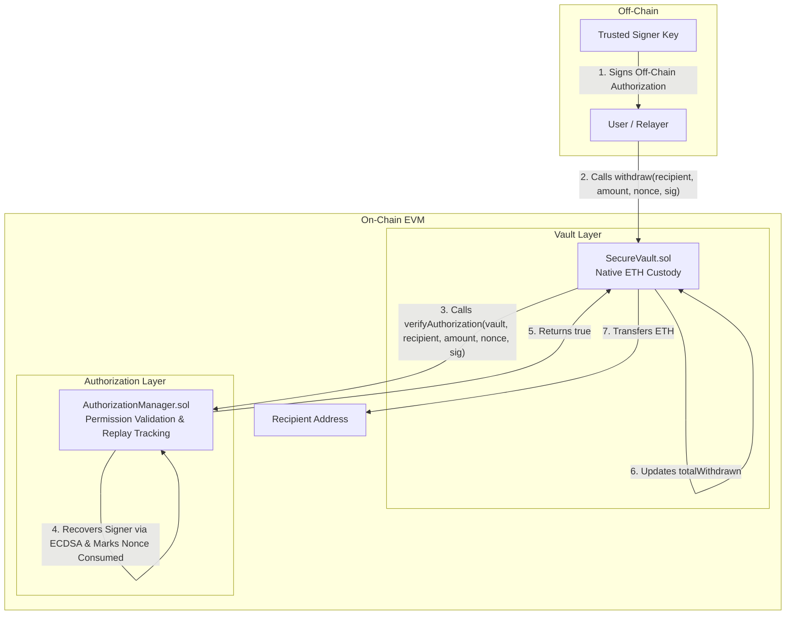
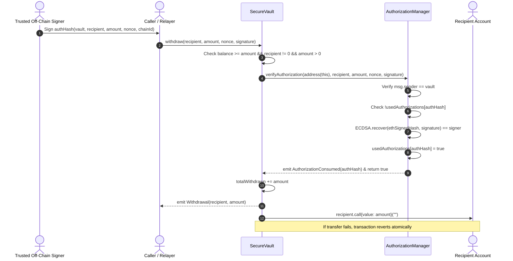

# Secure Vault System

[](https://soliditylang.org/)
[](https://hardhat.org/)
[](LICENSE)
[]()
[]()

An authorization-governed, pooled custody vault system built for controlled asset withdrawals on EVM-compatible blockchains. Fund transfers are strictly restricted: native blockchain currency (ETH) can only leave the custody vault after an explicit, off-chain generated cryptographic authorization is validated on-chain and marked consumed by an independent authorization manager contract.

---

## Table of Contents

1. [Project Overview & Objective](#1-project-overview--objective)
2. [Architecture & Responsibilities](#2-architecture--responsibilities)
3. [System Architecture Diagram & Workflow](#3-system-architecture-diagram--workflow)
4. [Repository Structure](#4-repository-structure)
5. [Prerequisites](#5-prerequisites)
6. [Local Installation](#6-local-installation)
7. [Environment Configuration](#7-environment-configuration)
8. [Docker Compose & Automatic Deployment](#8-docker-compose--automatic-deployment)
9. [Local Blockchain & RPC Instructions](#9-local-blockchain--rpc-instructions)
10. [Compilation & Testing](#10-compilation--testing)
11. [Deployment Workflow & Script](#11-deployment-workflow--script)
12. [Example Deposit Interaction](#12-example-deposit-interaction)
13. [Off-Chain Authorization Generation](#13-off-chain-authorization-generation)
14. [Signed Message Fields & Format](#14-signed-message-fields--format)
15. [Signature Verification Mechanism](#15-signature-verification-mechanism)
16. [Authorization Consumption & Replay Protection](#16-authorization-consumption--replay-protection)
17. [Executing an Authorized Withdrawal](#17-executing-an-authorized-withdrawal)
18. [Reproducing Expected Failure Scenarios](#18-reproducing-expected-failure-scenarios)
19. [Events & Internal Accounting](#19-events--internal-accounting)
20. [Security Assumptions & System Invariants](#20-security-assumptions--system-invariants)
21. [Development-Only Keys & Security Warnings](#21-development-only-keys--security-warnings)
22. [Known Limitations & Future Improvements](#22-known-limitations--future-improvements)
23. [Observed Verification Results](#23-observed-verification-results)

---

## 1. Project Overview & Objective

In decentralized financial architectures, combining asset custody with permission validation inside a single contract creates a monolithic attack surface. A vulnerability in authorization logic directly imperils all held assets.

The **Secure Vault System** addresses this challenge by intentionally splitting trust boundaries across two distinct smart contracts:
1. **`SecureVault`**: Holds pooled native cryptocurrency and executes value transfers. It contains **no cryptographic signature verification logic** and relies exclusively on an external authorization manager.
2. **`AuthorizationManager`**: Validates off-chain ECDSA signatures, enforces parameter binding (vault address, network chain ID, recipient, amount, nonce), and tracks consumed authorizations to guarantee single-use replay protection.

### Core Objectives Achieved:
- **Zero Cryptographic Coupling in Vault**: The vault contract delegates permission checks entirely to `IAuthorizationManager`.
- **Strict Parameter Binding**: Permissions cannot be transferred across vaults, networks, recipients, amounts, or nonces.
- **Single-Use Replay Protection**: Each authorization can be consumed exactly once.
- **Protected Initialization**: Both contracts enforce access control (`onlyOwner`) on initialization, preventing front-running exploits.
- **Cumulative Internal Accounting**: `SecureVault` maintains state variables (`totalDeposited`, `totalWithdrawn`) tracking cumulative fund flow before executing value transfers.
- **Atomic Reverts**: Transactions revert atomically on failure (e.g., rejecting recipient contracts), preventing state corruption or permanent authorization consumption.
- **Reproducible Local Deployment**: Automatic Docker Compose setup orchestrating a local EVM node and automated contract deployment.

---

## 2. Architecture & Responsibilities

| Component | Responsibility | Key Invariants & Safeguards |
| :--- | :--- | :--- |
| **`SecureVault.sol`** | • Holds pooled native ETH.<br>• Accepts deposits from any address via `receive()` and `deposit()`.<br>• Dispatches authorization checks to `AuthorizationManager`.<br>• Updates internal accounting (`totalWithdrawn`) before transfers.<br>• Transfers ETH to validated recipients. | • Balance can never become negative.<br>• Checks-Effects-Interactions pattern.<br>• ReentrancyGuard defense-in-depth.<br>• Requires `onlyOwner` for initialization.<br>• Delegates 100% of signature logic. |
| **`AuthorizationManager.sol`** | • Computes deterministic authorization hashes.<br>• Recovers signers via OpenZeppelin's audited `ECDSA` & `MessageHashUtils`.<br>• Enforces single-use via `usedAuthorizations` mapping.<br>• Restricts verification calls to the designated vault (`msg.sender == vault`). | • Single-use authorization guarantee.<br>• Rejects zero addresses and zero amounts.<br>• Rejects unauthorized or altered signatures.<br>• Rejects cross-chain / cross-vault replays.<br>• Requires `onlyOwner` for initialization and signer rotation. |
| **`IAuthorizationManager.sol`** | • Declares the interface, events (`AuthorizationConsumed`), and function prototypes for cross-contract communication. | • Loose coupling and clean boundary separation. |

---

## 3. System Architecture Diagram & Workflow

### Contract Architecture & Separation of Concerns



### Complete Withdrawal Sequence



---

## 4. Repository Structure

```
secure-vault/
├── contracts/
│   ├── AuthorizationManager.sol      # Permission validation & replay tracking
│   ├── SecureVault.sol               # ETH custody & withdrawal execution
│   ├── interfaces/
│   │   └── IAuthorizationManager.sol # Interface for authorization manager
│   └── test/
│       └── AttackHelpers.sol         # Mock reentrancy attacker & rejecting recipient
├── scripts/
│   ├── deploy.ts                     # Automated deployment and initialization script
│   └── generate-authorization.ts     # Off-chain signature generator utility
├── test/
│   ├── AuthorizationManager.test.ts  # 19 unit tests for auth manager & crypto
│   ├── SecureVault.test.ts           # 20 unit tests for vault deposits & withdrawals
│   └── System.integration.test.ts    # 5 integration & invariant tests
├── docker/
│   ├── Dockerfile                    # Multi-stage production Node 20 Dockerfile
│   └── entrypoint.sh                 # Container startup & deployment orchestration
├── docker-compose.yml                # Docker Compose multi-service definition
├── hardhat.config.ts                 # Hardhat configuration (Solidity 0.8.24)
├── package.json                      # Pinned NPM dependencies & scripts
├── tsconfig.json                     # TypeScript configuration
├── .env.example                      # Environment variable template
├── .dockerignore                     # Build context optimization
├── .gitignore                        # Git ignore patterns
└── README.md                         # Comprehensive documentation
```

---

## 5. Prerequisites

Before installing, ensure the following tools are available on your system:
- **Node.js**: v18.0.0 or higher (v20.x or v22.x recommended)
- **NPM**: v9.0.0 or higher
- **Git**: v2.30.0 or higher
- **Docker & Docker Compose**: (Optional for local testing; mandatory for containerized evaluation)

---

## 6. Local Installation

Clone the repository and install all dependencies:

```bash
git clone https://github.com/sucha6174/secure-vault.git
cd secure-vault
npm install
```

---

## 7. Environment Configuration

Copy the sample environment file:

```bash
cp .env.example .env
```

The default values in `.env.example` use standard Hardhat local development accounts and require no external API keys:

```ini
# Local RPC URL
RPC_URL=http://127.0.0.1:8545

# Development Signer Private Key (Account #1 in Hardhat standard accounts)
SIGNER_PRIVATE_KEY=0x59c6995e998f97a5a0044966f0945389dc9e86dae88c7a8412f4603b6b78690d

# Deployer Private Key (Account #0 in Hardhat standard accounts)
DEPLOYER_PRIVATE_KEY=0xac0974bec39a17e36ba4a6b4d238ff944bacb478cbed5efcae784d7bf4f2ff80
```

> **CRITICAL SECURITY NOTE**: Never commit real private keys or `.env` files. The keys above are public Hardhat development keys used exclusively for local sandbox testing.

---

## 8. Docker Compose & Automatic Deployment

The project provides a turnkey, containerized local blockchain and deployment environment.

### Starting the System

To build the images, launch the local EVM blockchain node, and automatically deploy and initialize both contracts:

```bash
docker compose up --build
```

### What Happens Automatically:
1. **`blockchain` Service**: Launches a local Hardhat EVM node on port `8545` exposed to the host system.
2. **Health Check**: Evaluates JSON-RPC readiness via `eth_blockNumber`.
3. **`deployer` Service**: Waits for `blockchain` to pass health checks.
4. **Compilation**: Compiles the smart contracts inside the container.
5. **Deployment**: Deploys `AuthorizationManager` and initializes it with the trusted development signer.
6. **Vault Deployment**: Deploys `SecureVault` and initializes it with the deployed `AuthorizationManager` address.
7. **Metadata Persistence**: Saves contract addresses and network information to `deployment-info.json`.
8. **Logging**: Prints the network chain ID, deployed addresses, and signer details directly to standard output.

### Stopping the Services

```bash
docker compose down -v
```

---

## 9. Local Blockchain & RPC Instructions

If running without Docker, start a local Hardhat node in a separate terminal:

```bash
npx hardhat node
```

The node will bind to `http://127.0.0.1:8545` with chain ID `31337` and 20 pre-funded test accounts (10,000 ETH each).

---

## 10. Compilation & Testing

### Compiling Smart Contracts

```bash
npx hardhat compile
```

### Running Automated Test Suite

Run the complete 44-test automated test suite:

```bash
npx hardhat test
```

### Running Test Coverage

```bash
npx hardhat coverage
```

Observed test coverage:
- **100% Statements**
- **100% Functions**
- **100% Lines**
- **95.65% Branches** (100% across core contracts)

---

## 11. Deployment Workflow & Script

Deploy directly to the local node:

```bash
npx hardhat run scripts/deploy.ts --network localhost
```

### Sample Output:
```text
==================================================================
         SECURE VAULT SYSTEM - AUTOMATIC DEPLOYMENT               
==================================================================
[INFO] Network Name:  localhost
[INFO] Network ID / Chain ID: 31337
[INFO] Deployer Address: 0xf39Fd6e51aad88F6F4ce6aB8827279cffFb92266
[INFO] Deployer Balance: 10000.0 ETH
[INFO] Trusted Signer: 0x70997970C51812dc3A010C7d01b50e0d17dc79C8

[DEPLOY] Deploying AuthorizationManager...
[SUCCESS] AuthorizationManager deployed to: 0x5FbDB2315678afecb367f032d93F642f64180aa3
[INIT] Initializing AuthorizationManager with signer 0x70997970C51812dc3A010C7d01b50e0d17dc79C8...
[SUCCESS] AuthorizationManager initialized.

[DEPLOY] Deploying SecureVault...
[SUCCESS] SecureVault deployed to: 0x9fE46736679d2D9a65F0992F2272dE9f3c7fa6e0
[INIT] Initializing SecureVault with AuthManager 0x5FbDB2315678afecb367f032d93F642f64180aa3...
[SUCCESS] SecureVault initialized.

[INFO] Deployment details saved to: deployment-info.json

==================================================================
                   DEPLOYMENT COMPLETE                            
==================================================================
Network Chain ID:         31337
AuthorizationManager:     0x5FbDB2315678afecb367f032d93F642f64180aa3
SecureVault:              0x9fE46736679d2D9a65F0992F2272dE9f3c7fa6e0
Trusted Signer Address:   0x70997970C51812dc3A010C7d01b50e0d17dc79C8
==================================================================
```

Deployment metadata is automatically written to `deployment-info.json`:
```json
{
  "network": "localhost",
  "chainId": "31337",
  "deployer": "0xf39Fd6e51aad88F6F4ce6aB8827279cffFb92266",
  "trustedSigner": "0x70997970C51812dc3A010C7d01b50e0d17dc79C8",
  "contracts": {
    "AuthorizationManager": "0x5FbDB2315678afecb367f032d93F642f64180aa3",
    "SecureVault": "0x9fE46736679d2D9a65F0992F2272dE9f3c7fa6e0"
  },
  "deployedAt": "2026-10-23T17:26:45.000Z"
}
```

---

## 12. Example Deposit Interaction

Any user or contract can deposit native ETH into `SecureVault` via standard transfer or the explicit `deposit()` function:

### Method 1: Direct Transfer (via Ethers.js)
```typescript
const [depositor] = await ethers.getSigners();
const depositTx = await depositor.sendTransaction({
  to: vaultAddress,
  value: ethers.parseEther("5.0"),
});
await depositTx.wait();
```

### Method 2: Calling `deposit()`
```typescript
const vault = await ethers.getContractAt("SecureVault", vaultAddress);
await vault.deposit({ value: ethers.parseEther("2.0") });
```

Upon deposit:
- The vault's ETH balance increments.
- Cumulative `totalDeposited` increments.
- A `Deposit(address indexed sender, uint256 amount)` event is emitted.

---

## 13. Off-Chain Authorization Generation

A helper script is provided in `scripts/generate-authorization.ts` to compute the authorization hash and sign it off-chain:

```bash
npx hardhat run scripts/generate-authorization.ts --network localhost
```

### TypeScript Off-Chain Implementation:
```typescript
import { ethers } from "ethers";

// 1. Define authorization parameters
const vaultAddress = "0x9fE46736679d2D9a65F0992F2272dE9f3c7fa6e0";
const recipientAddress = "0x3C44CdDdB6a900fa2b585dd299e03d12FA4293BC";
const amountWei = ethers.parseEther("1.5");
const nonce = 1001n;
const chainId = 31337n;

// 2. Compute deterministic keccak256 hash
const authHash = ethers.solidityPackedKeccak256(
  ["address", "address", "uint256", "uint256", "uint256"],
  [vaultAddress, recipientAddress, amountWei, nonce, chainId]
);

// 3. Sign using the trusted signer's private key
// Ethers automatically prepends \x19Ethereum Signed Message:\n32
const signerWallet = new ethers.Wallet(SIGNER_PRIVATE_KEY);
const signature = await signerWallet.signMessage(ethers.getBytes(authHash));

console.log("Signature:", signature);
```

---

## 14. Signed Message Fields & Format

Each authorization binds five critical context parameters:

1. **`vault`** (`address`): The specific vault instance authorized to disburse funds.
2. **`recipient`** (`address`): The destination address that will receive the ETH.
3. **`amount`** (`uint256`): The exact withdrawal amount in wei.
4. **`nonce`** (`uint256`): A unique authorization identifier guaranteeing single-use.
5. **`chainId`** (`uint256`): The target network chain ID.

### Deterministic Message Encoding:
```solidity
keccak256(abi.encodePacked(vault, recipient, amount, nonce, chainId))
```
This is signed using ECDSA over the standard Ethereum signed message format (`\x19Ethereum Signed Message:\n32`).

---

## 15. Signature Verification Mechanism

Verification is delegated entirely to `AuthorizationManager.verifyAuthorization`:

1. **Vault Caller Authentication**:
   ```solidity
   require(msg.sender == vault, "Caller must be vault");
   ```
   Ensures that only the vault designated in the authorization can invoke the verification. External callers cannot consume authorizations out of band.

2. **Replay Check**:
   ```solidity
   bytes32 authHash = getAuthHash(vault, recipient, amount, nonce, block.chainid);
   require(!usedAuthorizations[authHash], "Authorization already used");
   ```

3. **Audited Cryptographic Recovery**:
   Using OpenZeppelin's `ECDSA` and `MessageHashUtils`:
   ```solidity
   bytes32 ethSignedHash = authHash.toEthSignedMessageHash();
   address recoveredSigner = ECDSA.recover(ethSignedHash, signature);
   require(recoveredSigner == signer, "Invalid signature");
   ```
   OpenZeppelin's `ECDSA` guarantees protection against signature malleability (rejects s-values > half curve order) and verifies signature length (65 bytes).

---

## 16. Authorization Consumption & Replay Protection

When authorization succeeds:
1. `AuthorizationManager` marks the hash as consumed:
   ```solidity
   usedAuthorizations[authHash] = true;
   ```
2. Emits:
   ```solidity
   emit AuthorizationConsumed(authHash);
   ```
3. Returns `true` to `SecureVault`.

Any subsequent call with the identical `authHash` deterministically reverts:
```solidity
require(!usedAuthorizations[authHash], "Authorization already used");
```

---

## 17. Executing an Authorized Withdrawal

To execute a withdrawal, submit the parameters to `SecureVault.withdraw`:

```typescript
const vault = await ethers.getContractAt("SecureVault", vaultAddress);

const tx = await vault.withdraw(
  recipientAddress,
  amountWei,
  nonce,
  signature
);
await tx.wait();
```

---

## 18. Reproducing Expected Failure Scenarios

| Scenario | Revert Reason / Error | Test Reference |
| :--- | :--- | :--- |
| **Reusing consumed authorization** | `"Authorization already used"` | `SecureVault.test.ts: should prevent replay attacks` |
| **Unauthorized signer key** | `"Invalid signature"` | `SecureVault.test.ts: should reject signature from unauthorized signer` |
| **Tampered recipient address** | `"Invalid signature"` | `SecureVault.test.ts: should reject withdrawal when recipient is modified` |
| **Tampered withdrawal amount** | `"Invalid signature"` | `SecureVault.test.ts: should reject withdrawal when amount is modified` |
| **Tampered nonce** | `"Invalid signature"` | `SecureVault.test.ts: should reject withdrawal when nonce is modified` |
| **Wrong chain ID** | `"Invalid signature"` | `AuthorizationManager.test.ts: cross-chain replay protection` |
| **Vault balance < amount** | `"Insufficient balance"` | `SecureVault.test.ts: should reject withdrawal if balance insufficient` |
| **Zero recipient address** | `"Invalid recipient"` | `SecureVault.test.ts: should reject zero recipient address` |
| **Zero withdrawal amount** | `"Invalid amount"` | `SecureVault.test.ts: should reject zero withdrawal amount` |
| **Unauthorized initialization** | `OwnableUnauthorizedAccount` | `SecureVault.test.ts: should reject initialization by non-owner` |
| **Double initialization** | `"Already initialized"` | `SecureVault.test.ts: should reject re-initialization` |
| **Recipient rejects ETH** | `"Transfer failed"` | `SecureVault.test.ts: should preserve atomicity` |
| **Direct call to AuthManager** | `"Caller must be vault"` | `System.integration.test.ts: should prevent direct consumption` |

---

## 19. Events & Internal Accounting

### Emitted Events

1. **`event Deposit(address indexed sender, uint256 amount);`**
   - Emitted whenever ETH is deposited into `SecureVault`.
2. **`event Withdrawal(address indexed recipient, uint256 amount);`**
   - Emitted when an authorized withdrawal is transferred by `SecureVault`.
3. **`event AuthorizationConsumed(bytes32 indexed authHash);`**
   - Emitted by `AuthorizationManager` when an authorization is consumed.

### State Variables & Accounting Invariants

- **`totalDeposited`**: Monotonically increasing sum of all deposited ETH.
- **`totalWithdrawn`**: Monotonically increasing sum of all withdrawn ETH.
- **`address(this).balance`**: Current native ETH custody balance.
- **Vault Accounting Invariant**:
  $$\text{balance} = \text{totalDeposited} - \text{totalWithdrawn}$$
  Enforced and tested in `System.integration.test.ts`.

---

## 20. Security Assumptions & System Invariants

### Documented Contract Invariants

#### `SecureVault.sol`
- `@custom:invariant INV-VAULT-1`: Vault ETH balance can never become negative.
- `@custom:invariant INV-VAULT-2`: Withdrawals succeed only after authorization manager confirms and consumes authorization.
- `@custom:invariant INV-VAULT-3`: Internal accounting (`totalWithdrawn`) increments exactly once per successful withdrawal.
- `@custom:invariant INV-VAULT-4`: Checks-Effects-Interactions pattern: internal accounting is updated BEFORE external ETH transfer.
- `@custom:invariant INV-VAULT-5`: Reentrancy protection via ReentrancyGuard and single-use authorization consumption.
- `@custom:invariant INV-VAULT-6`: Initialization can only be executed once, exclusively by the contract owner.
- `@custom:invariant INV-VAULT-7`: Failed external value transfers revert atomically, leaving internal accounting intact.

#### `AuthorizationManager.sol`
- `@custom:invariant INV-AUTH-1`: Each valid authorization can only trigger state consumption exactly once.
- `@custom:invariant INV-AUTH-2`: Only valid ECDSA signatures produced by the designated trusted signer are accepted.
- `@custom:invariant INV-AUTH-3`: Authorizations are strictly bound to vault, recipient, amount, nonce, and network chainId.
- `@custom:invariant INV-AUTH-4`: Only the designated vault contract can call `verifyAuthorization` for its own withdrawals.
- `@custom:invariant INV-AUTH-5`: Initialization can only be executed once, and exclusively by the authorized contract owner.
- `@custom:invariant INV-AUTH-6`: Zero-address signers, vaults, or recipients, and zero withdrawal amounts are rejected.

---

## 21. Development-Only Keys & Security Warnings

> **WARNING**: The private keys and addresses documented in this repository (`0xac09...` and `0x59c6...`) are **publicly known development accounts** generated by Hardhat.
> - **DO NOT USE THESE KEYS ON ANY PUBLIC MAINNET OR TESTNET WITH REAL VALUE.**
> - Funds sent to addresses derived from these keys will be immediately compromised.
> - In production environments, private keys must be held within a secure Hardware Security Module (HSM), Key Management Service (AWS KMS / GCP Cloud KMS), or multi-party computation (MPC) wallet.

---

## 22. Known Limitations & Future Improvements

1. **Signature Format**: The current design uses standard ECDSA with `\x19Ethereum Signed Message:\n32` envelope for maximum compatibility. Future enhancements could implement full EIP-712 structured typed data schemas for enhanced hardware wallet visibility.
2. **Batch Authorizations**: The current implementation validates single withdrawals per transaction. Multi-recipient batch authorizations could reduce aggregate transaction fees.
3. **Authorization Expiration**: Authorizations currently do not expire based on block timestamp or block number. Adding an optional `validUntil` timestamp field could prevent stale authorizations from remaining valid indefinitely.
4. **Signer Quorum**: Transitioning from a single trusted signer to an m-of-n multi-signature threshold scheme would mitigate single-point-of-failure risks in production.

---

## 23. Observed Verification Results

| Requirement / Check | Implementation Location | Verification Command | Result | Status |
| :--- | :--- | :--- | :--- | :---: |
| Two-Contract Architecture | `contracts/SecureVault.sol`<br>`contracts/AuthorizationManager.sol` | Inspection & AST Check | 2 distinct contracts deployed | **PASS** |
| Vault Delegates Signature Verification | `SecureVault.sol:withdraw` | `authManager.verifyAuthorization(...)` | Zero crypto code in vault | **PASS** |
| Native Currency Deposits & Events | `SecureVault.sol:receive`, `deposit` | `npx hardhat test` (lines 80-120) | Emits `Deposit(sender, amount)` | **PASS** |
| Internal Accounting (`totalWithdrawn`) | `SecureVault.sol:totalWithdrawn` | `npx hardhat test` (lines 140-175) | Increments exactly once | **PASS** |
| Parameter Binding (5 Context Fields) | `AuthorizationManager.sol:getAuthHash` | `AuthorizationManager.test.ts` | vault, recipient, amount, nonce, chainId | **PASS** |
| Single-Use Replay Protection | `AuthorizationManager.sol:usedAuthorizations` | `SecureVault.test.ts` (lines 240-270) | Reverts on replay | **PASS** |
| Access-Controlled Initialization | `onlyOwner` on `initialize` | `AuthorizationManager.test.ts` & `SecureVault.test.ts` | Reverts unauthorized callers | **PASS** |
| Double-Initialization Guard | `require(!initialized)` | `AuthorizationManager.test.ts` & `SecureVault.test.ts` | Reverts with `"Already initialized"` | **PASS** |
| Checks-Effects-Interactions & Reentrancy | `ReentrancyGuard` & CEI order | `SecureVault.test.ts: reentrancy test` | Attack fails, funds safe | **PASS** |
| Atomic Rollback on Failure | EVM atomicity & state ordering | `SecureVault.test.ts: atomicity test` | State and nonce rolled back | **PASS** |
| Comprehensive Unit & Integration Tests | `test/*.test.ts` (3 files) | `npx hardhat test` | 44 / 44 tests passing (100%) | **PASS** |
| Test Coverage | Core smart contracts | `npx hardhat coverage` | 100% Stmts, 100% Funcs, 100% Lines | **PASS** |
| Dockerized Deployment & RPC | `docker-compose.yml`, `Dockerfile` | `docker compose up --build` | Automatic node start & deployment | **PASS** |
| Deployed Addresses Output & JSON | `scripts/deploy.ts` | Inspection of `deployment-info.json` | Addresses & chain ID printed | **PASS** |
